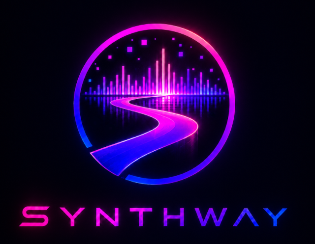
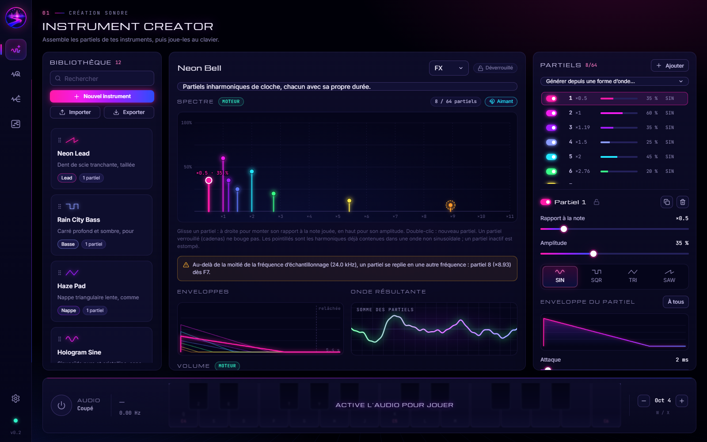
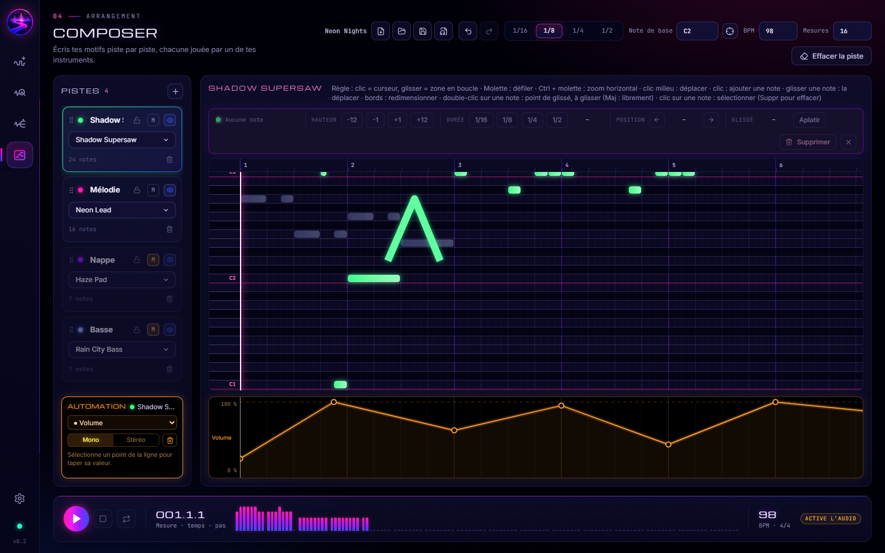
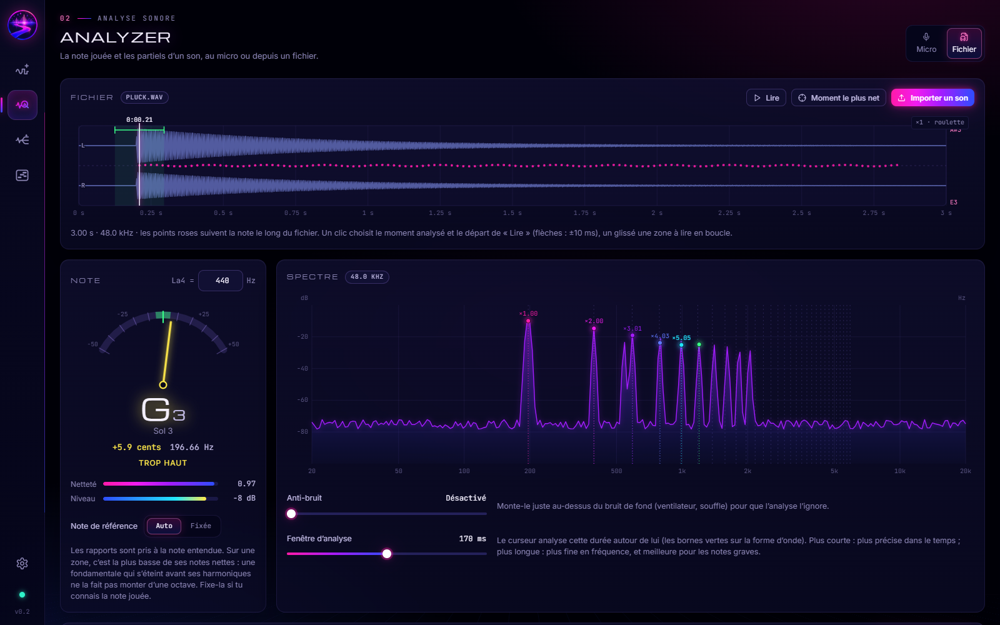
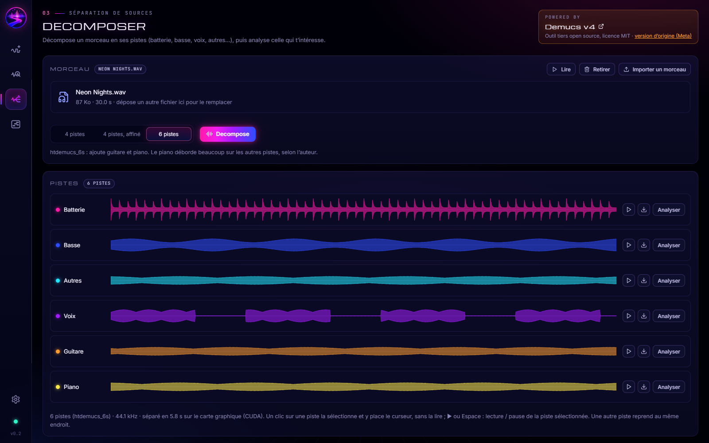
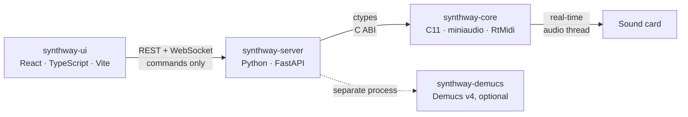
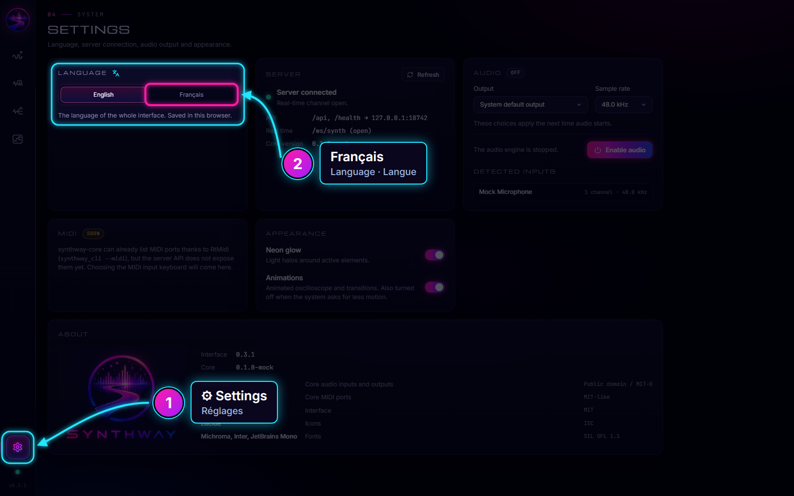

<p align="center">
  <strong>English</strong> · <a href="README.fr.md">Français</a>
</p>

<p align="center">
  
</p>

<p align="center">
  <strong>An additive synthesizer you sculpt partial by partial, from your browser.</strong><br>
  Design your sounds, compose your songs, analyze a recording and turn it into an instrument.
</p>

<p align="center">
  <a href="#features">Features</a> ·
  <a href="#architecture">Architecture</a> ·
  <a href="#quick-start">Quick start</a> ·
  <a href="#language">Language</a> ·
  <a href="docs/developpement.md">Developer guide (French)</a>
</p>

---

Synthway brings together, in one web interface, a timbre editor, a multitrack sequencer, a sound analyzer and a source separation tool. The sound itself never goes through the browser: it is computed by an engine written in C, in its own audio thread, as close to the sound card as possible. The interface and the server only send commands (notes, settings): no audio stream ever travels through Python or over the network.

## Features

### 🎛️ Instrument Creator: sculpt a sound



- **Additive synthesis**: up to 64 partials per instrument. Each one has its own ratio to the note (harmonic or not, from ×0.01 to ×1000), amplitude, waveform (sine, square, triangle, sawtooth) and envelope.
- **Spectrum you edit with the mouse**: drag a partial to the right to raise its pitch, upwards for its amplitude; the envelopes and the resulting waveform follow live.
- **Band-pass filter, reverb and unison**: up to 8 detuned voices per partial, with their stereo width.
- **Presets** to get started (lead, bass, pad, organ, bell, supersaw…), and instruments shared as `.swinst` files.
- **Playable right away** with the computer keyboard (AZERTY or QWERTY) or the mouse.

### 🎼 Composer: write a song



- **Multitrack piano roll**: each track is played by one of your instruments, the other tracks stay visible in transparency.
- **Pitch glides**: double-click a note to put a point on it, then drag it to the pitch you want.
- **Automation**: volume, pan, low-pass, high-pass, resonance, reverb and detune change along the song, in mono or separately on the left and right.
- **Undo / redo**, and songs saved as `.swsong` files together with the instruments they use.
- **WAV or OGG export**: the song is rendered offline by the same engine as playback, every note at the exact sample.

### 🔬 Analyzer: understand a sound



- **From the microphone or a file** (WAV, FLAC, MP3): tuner (note, offset in cents, frequency), measured spectrum and list of partials.
- **The note followed all along a file**: a click picks the analyzed moment, and the Analyzer tells which waveform the sound is closest to.
- **From a sound to an instrument**: the measured partials become a trial instrument, playable on the keyboard, then saved to the library.

### 🎚️ Decomposer: split a song into stems (optional)



- A song (WAV, FLAC, MP3, OGG) split into 4 or 6 stems (drums, bass, vocals, other, guitar, piano) by [Demucs v4](https://github.com/adefossez/demucs).
- Each stem can be played, downloaded, or sent to the Analyzer to make an instrument out of it.
- Module installed separately (PyTorch, about 3 GB). Demucs' pre-trained weights have no clear license: this module is meant for a local trial only, see [`synthway-demucs/README.md`](synthway-demucs/README.md).

## Architecture



| Folder | Role | Technologies |
| --- | --- | --- |
| [`synthway-core/`](synthway-core/) | Real-time engine: synthesis, playback, analysis, WAV and OGG rendering, audio devices, list of MIDI ports | C11 (C++17 for RtMidi), shared library |
| [`synthway-server/`](synthway-server/) | REST and WebSocket API, drives the engine through FFI | Python, FastAPI |
| [`synthway-ui/`](synthway-ui/) | Control interface | React, TypeScript, Vite |
| [`synthway-demucs/`](synthway-demucs/) | Source separation, optional | Demucs v4, PyTorch |

The journey of a note, from the interface to the sound card, is described in [`docs/architecture.md`](docs/architecture.md) (in French).

## Quick start

### Windows: nothing to install

1. Download `Synthway-<version>-windows-x64.zip` from the repository's **Releases** page.
2. Unzip it wherever you like.
3. Double-click `synthway.bat`.

Synthway opens in your browser. Turn the audio on with the ⏻ button of the keyboard, at the bottom of the screen. To quit, close the black window.

The engine, the interface and Python are all in the folder: nothing is installed on the computer, and deleting the folder is enough to uninstall. If Windows shows “Windows protected your PC” on the first launch, click “More info”, then “Run anyway”.

### From the sources

**Requirements:** Python 3.9 or newer, Node.js 18 or newer and a C11 and C++17 compiler. miniaudio, RtMidi, libogg and libvorbis are included in the repository.

- **Windows:** install Python, Node.js and [MSYS2](https://www.msys2.org/), which provides the compiler:

  ```powershell
  winget install Python.Python.3.13
  winget install OpenJS.NodeJS.LTS
  winget install MSYS2.MSYS2
  ```

  Then, in the “MSYS2 UCRT64” terminal (Start menu):

  ```bash
  pacman -S --needed mingw-w64-ucrt-x86_64-gcc
  ```

- **Linux (Debian, Ubuntu):** `sudo apt install build-essential libasound2-dev python3-venv nodejs npm` (Node.js 18 or newer).

Then start Synthway:

- **Windows:** double-click `synthway.bat`.
- **Linux:** `./synthway.sh` in a terminal, or double-click it (or else: `python3 synthway.py`).

The launcher prepares whatever is missing. On the first launch, it builds the engine, installs the server and interface packages and builds the interface, which takes a few minutes. It then starts the server, which also serves the interface, and opens Synthway in the browser ([http://127.0.0.1:18741](http://127.0.0.1:18741)). To stop everything: Ctrl+C, or close the window.

The next launches are immediate. After an update of the repository, the launcher only redoes what changed. Options (`python synthway.py --help`): `--no-browser`, `--port`.

**Optional: the Decomposer**

```bash
cd synthway-demucs
uv sync
```

It needs [uv](https://docs.astral.sh/uv/). Then restart Synthway.

Synthway runs on Windows and Linux. Under WSL, the sound goes through WSLg and arrives about half a second late: run Synthway on Windows instead. Starting each layer by hand, tests, and the mock server to work without sound: see the [developer guide](docs/developpement.md) (in French).

## Language

The interface speaks **English** (the default) and **French**. To switch:



1. Click the ⚙ gear at the bottom of the left bar: this is the **Settings** screen.
2. In the **Language** card, at the top left, click **Français** (or **English** to come back).

The whole interface switches at once, and keeps this language for the next launches: the choice is saved in the browser.

> 🇫🇷 **Interface en français :** cliquez sur l'engrenage ⚙ en bas de la barre de gauche (**Settings**), puis sur **Français** dans la carte **Language**. Ce README existe aussi [en français](README.fr.md).

The interface texts live in `synthway-ui/src/i18n/locales/`: `en.json` for English, `fr.json` for French. To add a language, see the [developer guide](docs/developpement.md#langues-de-linterface) (in French).

### Themes

Not into neon? In **Settings**, the **Appearance** card switches the whole interface between four themes, at once:

- **Synthwave** (the default): neon pink, violet and blue on night, haze and horizon grid.
- **Retro light**: warm paper, white cards drawn with orange lines, a seventies sunset of amber, orange and rust.
- **Deep blue**: flat ink with a single electric blue, square and quiet.
- **Graphite**: black and greys, colour kept for your partials and tracks.

A theme is a folder of `synthway-ui/src/themes/`, mostly one file of colour variables: see [how to make one](synthway-ui/src/themes/README.md) (in French).

## Project status

Synthway is young: each layer is a first draft, and its APIs may still change. It is developed on Windows, where sound and microphone get tested; the engine also builds and passes its tests on Linux. The engine can already list MIDI ports; playing from a MIDI keyboard is coming.

## Contributing

- [`docs/developpement.md`](docs/developpement.md): file tree, building and architecture rules of each layer.
- [`docs/architecture.md`](docs/architecture.md): how the interface, the server and the engine talk to each other.
- [`docs/formats-de-fichier.md`](docs/formats-de-fichier.md): the `.swsong` (songs) and `.swinst` (instruments) formats.
- Each folder has its own `README.md`, with its API and its commands.

The developer documentation is written in French. Synthway is developed with the help of AI agents (Claude Code, Gemini); their shared instructions, which apply to humans too, are in [`AGENTS.md`](AGENTS.md).

## Credits

Synthway builds on open source projects:

| Project | Used for | License |
| --- | --- | --- |
| [miniaudio](https://github.com/mackron/miniaudio) | Audio output and input, file decoding | Public domain or MIT-0 |
| [RtMidi](https://github.com/thestk/rtmidi) | List of MIDI ports | MIT-like |
| [libogg](https://xiph.org/ogg/) and [libvorbis](https://xiph.org/vorbis/) | OGG export | BSD-3-Clause, © Xiph.Org Foundation |
| [FastAPI](https://fastapi.tiangolo.com/), [Uvicorn](https://www.uvicorn.org/) | Server | MIT, BSD-3-Clause |
| [React](https://react.dev/), [Vite](https://vite.dev/), [Lucide](https://lucide.dev/) | Interface, icons | MIT, MIT, ISC |
| Michroma, Inter, JetBrains Mono | Interface fonts | SIL OFL 1.1 |
| [Demucs](https://github.com/adefossez/demucs) | Source separation (optional) | MIT for the code; weights without a clear license |

Versions, sources and notices: [`synthway-core/vendor/README.md`](synthway-core/vendor/README.md) and [`synthway-ui/src/assets/fonts/README.md`](synthway-ui/src/assets/fonts/README.md).

## License

Synthway is distributed under the [Apache 2.0](LICENSE) license. The third-party libraries and fonts included in the repository keep their own license (see [Credits](#credits)); Demucs' weights, downloaded separately by the optional module, are not part of it.
