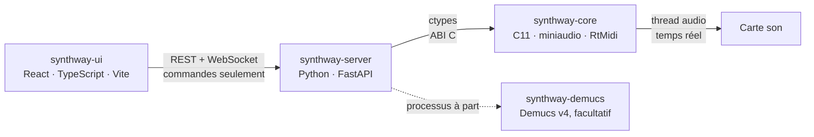

<p align="center">
  
</p>

<p align="center">
  <strong>Un synthétiseur additif qu'on sculpte partiel par partiel, depuis le navigateur.</strong><br>
  Créez vos sons, composez vos morceaux, analysez un enregistrement pour en faire un instrument.
</p>

<p align="center">
  <a href="#fonctionnalités">Fonctionnalités</a> ·
  <a href="#architecture">Architecture</a> ·
  <a href="#démarrage-rapide">Démarrage rapide</a> ·
  <a href="docs/developpement.md">Guide de développement</a>
</p>

---

Synthway réunit dans une même interface web un éditeur de timbres, un séquenceur multi-pistes, un analyseur de son et un outil de séparation de sources. Le son, lui, ne passe jamais par le navigateur : il est calculé par un moteur écrit en C, dans son propre thread audio, au plus près de la carte son. L'interface et le serveur n'envoient que des commandes (notes, réglages) : aucun flux audio ne transite par Python ni par le réseau.

## Fonctionnalités

### 🎛️ Instrument Creator : sculpter un son


- **Synthèse additive** : jusqu'à 64 partiels par instrument. Chacun a son rapport à la note (harmonique ou non, de ×0,01 à ×1000), son amplitude, sa forme d'onde (sinus, carré, triangle, dent de scie) et sa propre enveloppe.
- **Spectre éditable à la souris** : on glisse un partiel vers la droite pour monter sa hauteur, vers le haut pour son amplitude ; les enveloppes et l'onde résultante suivent en direct.
- **Filtre passe-bande, réverbération et unisson** : jusqu'à 8 voix désaccordées par partiel, avec leur largeur stéréo.
- **Préréglages** pour démarrer (lead, basse, nappe, orgue, cloche, supersaw…), et instruments partagés en fichiers `.swinst`.
- **Jouable tout de suite** au clavier de l'ordinateur (AZERTY ou QWERTY) ou à la souris.

### 🎼 Composer : écrire un morceau


- **Piano roll multi-pistes** : chaque piste est jouée par l'un de vos instruments, les autres restent visibles en transparence.
- **Glissés de hauteur** : un double-clic sur une note y pose un point, qu'on tire vers la hauteur voulue.
- **Automation** : volume, panoramique, passe-bas, passe-haut, résonance, réverbération et désaccord varient au fil du morceau, en mono ou séparément à gauche et à droite.
- **Annuler / rétablir**, et morceaux enregistrés en `.swsong` avec les instruments qu'ils utilisent.
- **Export WAV ou OGG** : le morceau est rendu hors ligne par le même moteur que la lecture, chaque note à l'échantillon près.

### 🔬 Analyzer : comprendre un son


- **Au micro ou depuis un fichier** (WAV, FLAC, MP3) : accordeur (note, écart en cents, fréquence), spectre mesuré et liste des partiels.
- **La note suivie tout le long d'un fichier** : un clic choisit le moment analysé, et l'Analyzer dit de quelle forme d'onde le son est le plus proche.
- **D'un son à un instrument** : les partiels mesurés deviennent un instrument à l'essai, jouable au clavier, puis enregistré dans la bibliothèque.

### 🎚️ Decomposer : séparer les pistes d'un morceau (facultatif)


- Un morceau (WAV, FLAC, MP3, OGG) séparé en 4 ou 6 pistes (batterie, basse, voix, autres, guitare, piano) par [Demucs v4](https://github.com/adefossez/demucs).
- Chaque piste s'écoute, se télécharge, ou part dans l'Analyzer pour en tirer un instrument.
- Module installé à part (PyTorch, environ 3 Go). Les poids pré-entraînés de Demucs n'ont pas de licence claire : ce module est réservé à un essai local, voir [`synthway-demucs/README.md`](synthway-demucs/README.md).

## Architecture



| Dossier | Rôle | Technologies |
| --- | --- | --- |
| [`synthway-core/`](synthway-core/) | Moteur temps réel : synthèse, lecture, analyse, rendu WAV et OGG, périphériques audio, liste des ports MIDI | C11 (C++17 pour RtMidi), bibliothèque partagée |
| [`synthway-server/`](synthway-server/) | API REST et WebSocket, pilote le moteur par FFI | Python, FastAPI |
| [`synthway-ui/`](synthway-ui/) | Interface de contrôle | React, TypeScript, Vite |
| [`synthway-demucs/`](synthway-demucs/) | Séparation de sources, facultative | Demucs v4, PyTorch |

Le trajet d'une note, de l'interface jusqu'à la carte son, est décrit dans [`docs/architecture.md`](docs/architecture.md).

## Démarrage rapide

### Windows : rien à installer

1. Téléchargez `Synthway-<version>-windows-x64.zip` sur la page **Releases** du dépôt.
2. Dézippez-le où vous voulez.
3. Double-cliquez sur `synthway.bat`.

Synthway s'ouvre dans le navigateur. Activez l'audio avec le bouton ⏻ du clavier, en bas de l'écran. Pour quitter, fermez la fenêtre noire.

Le moteur, l'interface et Python sont dans le dossier : rien n'est installé sur l'ordinateur, et supprimer le dossier suffit pour désinstaller. Si Windows affiche « Windows a protégé votre ordinateur » au premier lancement, cliquez sur « Informations complémentaires », puis « Exécuter quand même ».

### Depuis les sources

**Prérequis :** Python 3.9 ou plus récent, Node.js 18 ou plus récent et un compilateur C11 et C++17. miniaudio, RtMidi, libogg et libvorbis sont fournis dans le dépôt.

- **Windows :** installez Python, Node.js et [MSYS2](https://www.msys2.org/), qui fournit le compilateur :

  ```powershell
  winget install Python.Python.3.13
  winget install OpenJS.NodeJS.LTS
  winget install MSYS2.MSYS2
  ```

  Puis, dans le terminal « MSYS2 UCRT64 » (menu Démarrer) :

  ```bash
  pacman -S --needed mingw-w64-ucrt-x86_64-gcc
  ```

- **Linux (Debian, Ubuntu) :** `sudo apt install build-essential libasound2-dev python3-venv nodejs npm` (Node.js 18 ou plus récent).

Puis lancez Synthway :

- **Windows :** double-cliquez sur `synthway.bat`.
- **Linux :** `./synthway.sh` dans un terminal, ou double-cliquez dessus (ou encore : `python3 synthway.py`).

Le lanceur prépare ce qui manque. Au premier lancement, il compile le moteur, installe les paquets du serveur et de l'interface et construit l'interface, ce qui prend quelques minutes. Il démarre ensuite le serveur, qui sert aussi l'interface, et ouvre Synthway dans le navigateur ([http://127.0.0.1:18741](http://127.0.0.1:18741)). Pour tout arrêter : Ctrl+C, ou fermez la fenêtre.

Les lancements suivants sont immédiats. Après une mise à jour du dépôt, le lanceur ne refait que ce qui a changé. Options (`python synthway.py --help`) : `--no-browser`, `--port`.

**Facultatif : le Decomposer**

```bash
cd synthway-demucs
uv sync
```

Il faut [uv](https://docs.astral.sh/uv/). Relancez ensuite Synthway.

Synthway tourne sous Windows et Linux. Sous WSL, le son passe par WSLg et arrive avec environ une demi-seconde de retard : lancez plutôt Synthway sous Windows. Lancement à la main couche par couche, tests et serveur factice pour travailler sans son : voir le [guide de développement](docs/developpement.md).

## État du projet

Synthway est jeune : chaque couche en est à son premier jet, et ses API peuvent encore changer. Il est développé sous Windows, où se testent le son et le micro ; le moteur compile et passe aussi ses tests sous Linux. Le moteur sait déjà lister les ports MIDI ; jouer depuis un clavier MIDI est à venir.

## Contribuer

- [`docs/developpement.md`](docs/developpement.md) : arborescence, compilation et règles d'architecture de chaque couche.
- [`docs/architecture.md`](docs/architecture.md) : comment l'interface, le serveur et le moteur communiquent.
- [`docs/formats-de-fichier.md`](docs/formats-de-fichier.md) : les formats `.swsong` (morceaux) et `.swinst` (instruments).
- Chaque dossier a son propre `README.md`, avec son API et ses commandes.

Synthway est développé avec l'aide d'agents IA (Claude Code, Gemini) ; leurs consignes communes, qui valent aussi pour les humains, sont dans [`AGENTS.md`](AGENTS.md).

## Crédits

Synthway s'appuie sur des projets open source :

| Projet | Usage | Licence |
| --- | --- | --- |
| [miniaudio](https://github.com/mackron/miniaudio) | Sortie et entrée audio, décodage de fichiers | Domaine public ou MIT-0 |
| [RtMidi](https://github.com/thestk/rtmidi) | Liste des ports MIDI | Type MIT |
| [libogg](https://xiph.org/ogg/) et [libvorbis](https://xiph.org/vorbis/) | Export OGG | BSD-3-Clause, © Xiph.Org Foundation |
| [FastAPI](https://fastapi.tiangolo.com/), [Uvicorn](https://www.uvicorn.org/) | Serveur | MIT, BSD-3-Clause |
| [React](https://react.dev/), [Vite](https://vite.dev/), [Lucide](https://lucide.dev/) | Interface, icônes | MIT, MIT, ISC |
| Michroma, Inter, JetBrains Mono | Polices de l'interface | SIL OFL 1.1 |
| [Demucs](https://github.com/adefossez/demucs) | Séparation de sources (facultative) | MIT pour le code ; poids sans licence claire |

Versions, sources et notices : [`synthway-core/vendor/README.md`](synthway-core/vendor/README.md) et [`synthway-ui/src/assets/fonts/README.md`](synthway-ui/src/assets/fonts/README.md).

## Licence

Synthway est distribué sous licence [Apache 2.0](LICENSE). Les bibliothèques et polices tierces fournies dans le dépôt gardent leur propre licence (voir [Crédits](#crédits)) ; les poids de Demucs, téléchargés à part par le module facultatif, n'en font pas partie.
