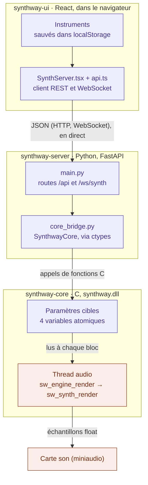
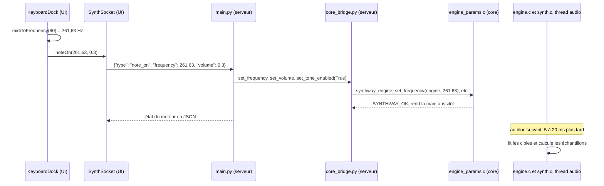
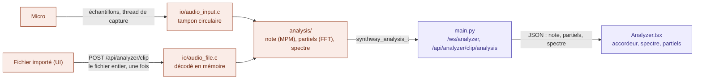
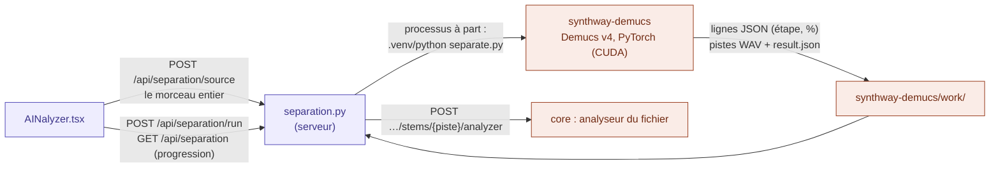

# Fonctionnement de Synthway

Ce document explique comment l'UI, le serveur et le core communiquent : qui stocke quoi, ce qui transite d'une couche à l'autre et ce qui se passe quand on joue une note. Pour démarrer le projet, voir le [README](../README.md) ; pour les règles de chaque couche, sa section « Guide pour les Développeurs Humains et Agents IA ».

> **État décrit :** le code au 30/10/2026, Analyzer compris. Les références visent des fonctions plutôt que des numéros de ligne, qui changent trop vite. Si tu modifies un flux décrit ici, mets ce document à jour.

## Vue d'ensemble

En violet, les commandes et les réglages ; en orange, le signal audio réel.

## L'idée clé : des commandes, pas de son

Deux sortes de données circulent, et elles ne voyagent pas de la même façon :

- **Les commandes** : « joue 261,63 Hz », « passe en dent de scie », « volume 0,3 ». Quelques nombres en JSON, qui descendent de l'UI au serveur puis au core.
- **Le signal audio** : des dizaines de milliers d'échantillons par seconde. Il ne quitte jamais le C : il est calculé dans le core et remis directement à la carte son.

Aucune fonction ne « joue une note ». `synthway_engine_start` démarre un thread audio qui calcule du son en boucle, même quand il est silencieux (il écrit alors des zéros). Les commandes ne font que modifier les réglages que cette boucle lit.

## Couche par couche

### UI → serveur

L'UI appelle des URL relatives (`/api`, `/health`, `/ws`) que Vite redirige vers `http://localhost:18741`, le port par défaut du serveur (`vite.config.ts`, réglable par `SYNTHWAY_SERVER_URL`). Le client est dans `synthway-ui/src/lib/api.ts`, et l'état partagé par les écrans dans `synthway-ui/src/lib/SynthServer.tsx`. Deux canaux pour le moteur (l'Analyzer a les siens, voir « L'Analyzer » plus bas) :

| Canal | Messages | Usage |
| --- | --- | --- |
| REST (HTTP) | `GET /health`, `GET /api/devices`, `POST /api/engine/start`, `POST /api/engine/stop`, `GET /api/engine/status`, `POST /api/synth/tone`, `POST /api/synth/envelope`, `POST` et `DELETE /api/synth/timbre` | Actions ponctuelles : connexion (vérifiée toutes les 4 s), liste des sorties audio, allumer ou couper le moteur, réglages initiaux |
| WebSocket `/ws/synth` | `note_on`, `note_off`, `set_param` | Temps réel : les notes et les réglages modifiés en direct. Le serveur répond à chaque message avec l'état du moteur |

Le WebSocket se reconnecte tout seul, avec un délai qui double de 0,5 à 8 s.

### Serveur → core

`core = SynthwayCore()` (dans `main.py`) ne crée **pas** le moteur. Ce constructeur (`core_bridge.py`) :

1. charge `synthway.dll` ou `libsynthway.so` avec `ctypes.CDLL` (chemin trouvé par `_find_library`, ou donné par `SYNTHWAY_CORE_LIB`) ;
2. déclare le type des arguments et du retour de chaque fonction C (`argtypes`, `restype`), pour que ctypes sache convertir un `float` Python en `c_float`, etc.

Le moteur est créé par `SynthwayCore.start_engine()` : `synthway_engine_create()` renvoie un pointeur, rangé dans `self._engine`. Pour Python, c'est une adresse opaque : il ne voit jamais le contenu de la structure C et ne la manipule que par les fonctions `synthway_engine_*`. `stop_engine()` arrête puis détruit ce moteur.

### Dans le core

Le core est lui-même découpé en sous-couches (détail et règles dans la section « Sous-couches du moteur » de [`synthway-core/README.md`](../synthway-core/README.md)) :

- **`src/engine/`, le chef d'orchestre** : cycle de vie, frontière entre threads, routage du synthé vers une sortie ;
- **`src/synth/`, le calcul du son** : oscillateur, enveloppe, lissage, et la somme des partiels d'un timbre. Il remplit un tampon et ignore l'existence de la carte son ;
- **`src/io/`, la couche du bord** : carte son et micro (miniaudio), liste des périphériques, ports MIDI, fichiers WAV, FLAC et MP3 ;
- **`src/analyzer/` et `src/analysis/`**, l'analyse, à part du moteur : voir « L'Analyzer » plus bas.

Tout l'état du moteur tient dans la `struct synthway_engine` (`synthway-core/src/engine/engine_internal.h`), partagée par deux threads :

| Champs | Écrits par | Lus par |
| --- | --- | --- |
| `params` (`sw_engine_params`, `engine_params.h`) : `target_frequency`, `target_volume`, `waveform`, `tone_enabled`, `env_attack`, `env_decay`, `env_sustain`, `env_release` (atomiques) | le thread de l'API, via les setters | le thread audio, une fois par bloc |
| `params.timbre` (`sw_timbre_exchange`) : triple tampon de `synthway_timbre_t`, les partiels | le thread de l'API, via `synthway_engine_set_timbre` | le thread audio, une fois par bloc, sans jamais attendre |
| `synth` (`sw_synth`, `synth.h`) : fréquence et volume lissés, gate, phase de l'oscillateur, étape et niveau de l'enveloppe, et la même chose pour chaque partiel (`partials`) | le thread audio seul | le thread audio seul |

- **Le thread de l'API** (celui de Python) appelle les setters de `engine_params.c`. `synthway_engine_set_frequency`, par exemple, vérifie la valeur, l'écrit dans `target_frequency` et rend la main : aucun son n'est produit à ce moment-là.
- **Le thread audio** est créé par miniaudio à l'ouverture de la carte son (`sw_audio_output_open`, dans `io/audio_output.c`) et réveillé par `synthway_engine_start`. miniaudio l'appelle ensuite toutes les 5 à 20 ms environ, pour réclamer un bloc d'échantillons. `sw_engine_render` (`engine.c`) lit alors une fois les réglages cibles (`sw_engine_params_snapshot`), puis `sw_synth_render` (`synth.c`) calcule chaque échantillon : forme d'onde × volume × enveloppe avec l'oscillateur unique ou, avec un timbre, la somme des partiels (forme d'onde du partiel à rapport × fréquence, × amplitude × enveloppe du partiel), × volume. La fréquence et le volume glissent progressivement vers leur cible, ce qui évite les sauts brusques. `tone_enabled` sert de porte (gate) à l'enveloppe ADSR : son passage à vrai lance l'attaque, son passage à faux le relâchement.

`sw_engine_render` sert aussi au rendu hors ligne (`synthway_engine_render`, `synthway_engine_render_to_wav`, dans `engine_offline.c`) : un moteur sans carte son, qui produit exactement les mêmes échantillons. C'est ce qu'utilisent les tests et le skill `sound-check`.

## Qui stocke quoi

| Donnée | Où elle vit | Durée de vie |
| --- | --- | --- |
| Instruments | UI : `localStorage`, clé `synthway.instruments.v1` | Dans ce navigateur |
| Instrument sélectionné | UI : `localStorage`, clé `synthway.selected-instrument.v1` | Dans ce navigateur |
| Composition | UI : `localStorage`, clé `synthway.composition.v1` | Dans ce navigateur |
| Sortie audio et fréquence d'échantillonnage choisies | UI : `localStorage`, clé `synthway.audio.v1` ; envoyées à `/api/engine/start` | Dans ce navigateur |
| État du moteur (fréquence, volume, forme d'onde, enveloppe, timbre, marche) | Core : `struct synthway_engine` | Jusqu'à l'arrêt du moteur |
| Dernière enveloppe et dernier timbre envoyés | Serveur : `SynthwayCore._envelope` et `_timbre` (`core_bridge.py`) | Tant que le serveur tourne ; réappliqués à chaque nouveau moteur |
| Échantillons audio | Core : tampon fourni par miniaudio | Quelques millisecondes |
| Échantillons du micro | Core : tampon circulaire de `sw_audio_input` (65 536 échantillons, ~1,4 s à 48 kHz) | Écrasés au fil de l'écoute, libérés à la fermeture du micro |
| Fichier importé dans l'Analyzer | Core : échantillons décodés dans l'analyseur des fichiers ; serveur : son nom (`AnalyzerHub.clip_name`) | Jusqu'au fichier suivant ou à l'arrêt du serveur |
| Réglages de l'Analyzer (source, entrée, La de référence, anti-bruit) | UI : `localStorage`, clés `synthway.analyzer.source.v1`, `synthway.analyzer.input.v1`, `synthway.analyzer.a4.v1`, `synthway.analyzer.noise-gate.v1` ; le seuil anti-bruit est envoyé au core à chaque écoute ou analyse de fichier | Dans ce navigateur |

Le serveur garde le pointeur vers le moteur, la dernière enveloppe, le dernier timbre et les derniers réglages du filtre. Il les réapplique parce qu'il recrée le moteur à chaque démarrage.

## Les instruments

**Ni le core ni le serveur ne connaissent les instruments.** Un instrument est un objet de l'UI : son type `Instrument`, les presets et `createInstrument()` sont dans `synthway-ui/src/lib/instruments.ts`. Créer un instrument n'envoie donc rien au serveur.

Un instrument est un ensemble de partiels (`TimbrePartial`) : chacun a un rapport à la note jouée, une amplitude, une forme d'onde, une enveloppe ADSR (linéaire ou exponentielle) et une couleur. Le moteur, lui, connaît un **timbre** (`synthway_timbre_t`, 64 partiels au plus) et un volume. Il garde aussi son oscillateur unique (une forme d'onde, une enveloppe), utilisé tant qu'aucun timbre n'est envoyé : c'est encore le cas du CLI sans `--partials` et du mode démonstration du serveur. Voici ce que devient chaque caractéristique d'un instrument au 30/10/2026 :

| Caractéristique | Ce qu'elle devient |
| --- | --- |
| Partiels | Convertis en timbre par `toTimbre` (`synthway-ui/src/lib/partials.ts`, sans la couleur ni l'identifiant), envoyés par `set_param` dès que l'audio est actif ou que l'instrument change (`InstrumentCreator.tsx`). Au démarrage de l'audio, le timbre part par `/api/synth/timbre` **avant** `/api/engine/start`, pour que le nouveau moteur naisse avec lui |
| Volume | Envoyé avec le timbre par `set_param`, et au démarrage de l'audio par `/api/synth/tone` |
| Filtre | Bornes basse et haute (20–20000 Hz) et résonance (0–1) envoyées avec le timbre par `set_param` ; le core applique un passe-bande biquad après la somme des partiels ; une borne à son extrémité (20 Hz en bas, 20 kHz en haut) ne filtre pas, les deux ensemble contournent le filtre. Les valeurs sont gardées par le serveur et réappliquées au démarrage du moteur ; une borne basse qui n'est pas sous la borne haute est refusée avant d'être gardée. Dans l'UI, les deux bornes sont les poignées d'une même barre |
| Nom, description, catégorie, couleurs | Purement visuels, propres à l'UI |
| Octave du clavier (`octave`) | Propre à l'UI : l'octave d'où part le clavier de l'Instrument Creator (`KeyboardDock`), la dernière jouée ; seules les fréquences des notes jouées partent au moteur |

Les vues de l'Instrument Creator n'affichent pas le vrai signal. Le spectre (`SpectrumGraph`) dessine les partiels et, en pointillés, les harmoniques qu'une onde non sinusoïdale contient déjà (`waveformHarmonics`). Les enveloppes (`EnvelopesGraph`, `EnvelopeGraph`) sont tracées à partir des réglages par `envelopeLevel` (`synthway-ui/src/lib/instruments.ts`), qui reprend les courbes linéaire et exponentielle de `synthway-core/src/synth/envelope.c`. L'oscilloscope (`WaveScope`) recalcule la somme des partiels en JavaScript avec `sampleWave` (`synthway-ui/src/lib/music.ts`), qui reprend les formules de `synthway-core/src/synth/oscillator.c`.

Les avertissements (repliement au-delà de la moitié de la fréquence d'échantillonnage, saturation) sont calculés par l'UI seule, avec la fréquence d'échantillonnage du moteur (`sample_rate` de `/api/engine/status`) ou, moteur arrêté, celle choisie dans les Réglages. Le core ne bloque ni l'un ni l'autre.

## Le trajet d'une note

1. `press()` (`KeyboardDock.tsx`) convertit la note MIDI en Hz : **c'est l'UI qui calcule la fréquence.**
2. `SynthSocket.noteOn` envoie `{"type": "note_on", "frequency": 261.63, "volume": 0.3}` sur le WebSocket.
3. Le gestionnaire `websocket_synth_endpoint` (`main.py`) démarre le moteur s'il est arrêté, puis appelle `set_frequency`, `set_volume` et `set_tone_enabled(True)`.
4. `core_bridge.py` traduit chaque appel en appel C, par exemple `self._lib.synthway_engine_set_frequency(self._engine, ctypes.c_float(freq))`.
5. Le core écrit trois variables atomiques et rend la main. Le serveur renvoie l'état du moteur à l'UI.
6. Au bloc suivant, le thread audio voit `tone_enabled` passer à vrai et lance l'attaque de l'enveloppe : le son monte jusqu'au niveau de maintien.
7. Au relâchement de la touche, l'UI envoie `note_off`, ce qui met `tone_enabled` à faux : le thread audio lance le relâchement, et le son s'éteint en `release` secondes.

Le moteur reste monophonique pour les notes directes du clavier et de l'aperçu de l'Instrument Creator. Le Composer cadence la partition au tempo et envoie les notes simultanées sous forme d'un timbre temporaire : chaque note devient un partiel accordé à sa fréquence et garde l'enveloppe de son instrument. Le moteur additionne ces partiels dans son thread audio (jusqu'à `max_partials`, 64 par défaut). Le transport gère lecture, pause, reprise et position de départ ; le playhead défile dans le roll. `src/interpreter/` fournit la sélection sans allocation des notes actives à un pas donné.

## Le rôle du serveur

Il transmet surtout, mais pas seulement :

- il traduit le JSON en appels C ;
- il gère la vie du moteur : création, démarrage **muet** (`start_engine` coupe le son avant `synthway_engine_start`, car un moteur neuf joue 440 Hz), destruction ;
- il démarre le moteur si un `note_on` arrive alors qu'il est arrêté (l'UI, elle, n'envoie de notes que moteur allumé) ;
- il garde l'enveloppe et le timbre, et les applique à chaque nouveau moteur ;
- il vérifie les bornes des valeurs avec Pydantic (`models.py`) sur les routes REST. Sur le WebSocket, seuls l'enveloppe et le timbre de `set_param` sont vérifiés. Un message invalide reçoit `{"error": ...}`, et la connexion reste ouverte ;
- il n'écoute que sur `127.0.0.1` et n'accepte que les pages locales (CORS), pour qu'aucun autre site ne pilote le moteur.

## L'Analyzer

L'Analyzer écoute au lieu de jouer, mais suit le même principe : **le son reste dans le core**. Seuls des résultats d'analyse (une note, une liste de partiels, un spectre de 256 points) remontent au serveur puis à l'UI. Il n'utilise pas le moteur : le core a pour lui un objet à part, `synthway_analyzer_t` (`include/synthway/analyzer.h`), et deux sous-couches à part, `src/analyzer/` (micro, fichier, mémoire de calcul) et `src/analysis/` (le calcul).

- **Micro** : l'UI envoie `start` sur `/ws/analyzer` ; le serveur appelle `synthway_analyzer_open_input`. Le thread de capture de miniaudio ne fait que copier les échantillons dans le tampon circulaire. Toutes les 50 ms, le serveur appelle `synthway_analyzer_analyze_input` dans un thread (`asyncio.to_thread`) : le core prend la dernière fenêtre (environ 170 ms) et l'analyse (environ 1 ms). Le micro se ferme sur `stop` ou quand la page se déconnecte. Une seule page l'écoute à la fois.
- **Enregistrement** : sur `record`, le serveur appelle `synthway_analyzer_start_recording`. Le thread de capture ne change rien à son travail. C'est l'appel suivant à `synthway_analyzer_analyze_input`, toutes les 50 ms, qui recopie les nouveaux échantillons du tampon circulaire (5 s) dans l'enregistrement, en mémoire et sans limite de durée. Ce qui serait écrasé avant d'être pris devient du silence, compté comme perdu. Sur `stop_record` (ou à la fermeture du micro), l'enregistrement devient le « fichier » de l'analyseur du micro : `GET /api/analyzer/recording` le présente comme un fichier, et `GET /api/analyzer/recording.wav` le fait écrire en WAV par le core (`synthway_analyzer_save_clip_wav`) pour le télécharger ou le lire dans le navigateur. C'est le seul moment où des échantillons du micro sortent du core.
- **Fichier** : avec le téléchargement d'un enregistrement et la lecture du fichier ou de l'enregistrement (que le navigateur reçoit en WAV), c'est le seul passage de données audio par le serveur. L'UI envoie le fichier entier dans le corps de `POST /api/analyzer/clip`, et le pont le passe tel quel à `synthway_analyzer_load_clip_memory`, qui le décode. Le serveur renvoie la forme d'onde (1000 crêtes) et la note tout le long du fichier (`synthway_analyzer_get_clip_track`), puis analyse l'instant choisi par le curseur à chaque `GET /api/analyzer/clip/analysis?time=…`.
- **Fenêtre et zone** : `GET …/analysis` prend un instant (`time`) avec une fenêtre (`window_ms`), ou une zone (`start`, `end`). Le serveur appelle alors `synthway_analyzer_analyze_clip_range`, qui fait tout le calcul : l'instant `t` est la zone `[t − w/2, t + w/2]`, analysée d'une seule fenêtre ; une zone plus longue est analysée en 100 moments au plus, combinés par médiane dans `src/analysis/` (`sw_analysis_combine`). Avec `reference_hz` et `harmonic_cents`, le core prend les rapports à une note de référence, en ramenant la note de chaque moment dans son octave (les sauts d'octave d'un son dont la fondamentale s'éteint en premier ne mélangent plus les rapports), écarte les attaques et les autres notes, et ne garde au besoin que les harmoniques (`sw_analysis_relate`). L'UI fait de ces partiels une carte de l'Instrument Creator (`instrumentFromPartials`, `lib/instruments.ts`).
- **Enveloppes** : pour une zone, « Créer un instrument » demande d'abord `GET …/envelopes?start=…&end=…`. Le serveur appelle `synthway_analyzer_measure_envelopes`, qui trouve les partiels comme ci-dessus, puis suit le niveau de chacun toutes les 5 ms à sa fréquence (`sw_analysis_tone_amplitude`, un filtre de Goertzel) et en tire une enveloppe exponentielle (`sw_analysis_fit_envelope` : attaque, pente en dB/s, maintien si elle se stabilise, relâchement de 0,3 s au plus). Seules ces enveloppes et l'analyse remontent ; le moteur les joue avec la courbe `SYNTHWAY_ENVELOPE_EXPONENTIAL` de chaque partiel (`synth/envelope.c`).
- **Deux analyseurs** : un analyseur n'est pas thread-safe. Le serveur en a donc deux (`AnalyzerHub`, `main.py`), un pour le micro et un pour les fichiers, et chaque appel du pont prend un verrou (`Analyzer`, `core_bridge.py`).
- **La note** est trouvée par sa période (méthode de McLeod), puis vérifiée par les partiels, que la FFT mesure plus finement : affinée par ses premières harmoniques, ou remplacée par le premier partiel audible quand elle tombe sous lui sans en être la fondamentale absente (cas d'une cloche). Détails dans la section « Fonctionnalités » de [`synthway-core/README.md`](../synthway-core/README.md).

## L'AI-nalyzer

L'AI-nalyzer sépare un morceau en pistes (batterie, basse, voix, autres…) avant de l'analyser, pour qu'un beat ne se mêle pas au timbre mesuré. La séparation n'est pas faite par le core mais par Demucs v4, un réseau de neurones en Python et PyTorch, rangé à part dans `synthway-demucs/` avec son propre environnement. C'est un traitement de fichier hors ligne : aucun flux audio temps réel ne passe par Python.

- Le serveur n'importe jamais PyTorch : le Python de MSYS2 n'en a pas, et un plantage de Demucs ne doit pas emporter le serveur. Il lance `separate.py` avec le Python de `synthway-demucs/.venv`, dans un thread qui lit ses lignes JSON et tient l'état à jour ; l'UI le demande toutes les 500 ms pendant la séparation.
- Le morceau et ses pistes restent dans `synthway-demucs/work/` : ils reviennent après un redémarrage du serveur. « Analyser » relit une piste et la passe à l'analyseur du fichier, comme un fichier importé dans l'Analyzer.
- Sans `synthway-demucs` (ou avec `SYNTHWAY_DEMUCS=0`), tout le reste marche pareil : `GET /api/separation` dit pourquoi l'AI-nalyzer est indisponible.

## Pièges connus

- **Les formes d'onde sont numérotées à trois endroits** : `synthway_waveform_t` (`types.h`), `WaveformEnum` (`models.py`) et `WAVEFORM` (`synthway-ui/src/types.ts`). Les trois doivent rester identiques.
- **La limite de 64 partiels est écrite deux fois** : `SYNTHWAY_MAX_PARTIALS` (`types.h`) fixe la taille de `synthway_timbre_t`, et `MAX_PARTIALS` (`models.py`) celle de sa copie ctypes. Le pont refuse de charger un core dont la limite diffère. L'UI, elle, prend la valeur du serveur (`max_partials`). De même, `synthway_analysis_t` a sa copie ctypes (`SynthwayAnalysisC`) : le pont compare sa taille à `synthway_analysis_get_size()`.
- **Ouvrir le micro est une action sensible** : sous Windows, il faut que les applications de bureau aient accès au micro (Paramètres > Confidentialité > Microphone), sinon le core reçoit du silence ou ne peut pas l'ouvrir.
- **Les effets audio du système éteignent une note tenue** : en mode partagé, Windows applique au micro ses effets et ceux du fabricant (réduction de bruit, gain automatique ; Dolby sur les micros Intel Smart Sound), qui prennent un son stable pour du bruit de fond. Le core ouvre donc le micro en mode exclusif quand il le peut (`synthway_analyzer_is_input_exclusive`), et l'Analyzer prévient quand il n'a obtenu que le mode partagé.
- **Un timbre remplace la forme d'onde et l'enveloppe** : tant qu'un timbre est en place, `set_waveform` et `set_envelope` n'ont pas d'effet audible. `DELETE /api/synth/timbre` (ou `"timbre": null`) revient à l'oscillateur unique.
- **Le pont ignore les codes de retour des setters** (seul le rendu hors ligne les vérifie). Une fréquence hors bornes reçue par le WebSocket est refusée par le core sans que personne ne soit prévenu.
- **Un `note_on` porte ouverte ne relance pas l'attaque** (legato). Pour rejouer une note avec son attaque, il faut un `note_off` puis un `note_on`, séparés d'au moins un bloc.
- **Le core ne lit les réglages qu'une fois par bloc** : un réglage met jusqu'à un bloc (5 à 20 ms) à être pris en compte. C'est voulu (voir le commentaire de `sw_engine_render`, dans `engine.c`). Conséquence : un `note_off` suivi d'un `note_on` dans le même bloc n'est pas vu comme une nouvelle note.

## Ajouter un réglage de son de bout en bout

Un nouveau paramètre (enveloppe, filtre, désaccord…) traverse les quatre étages, toujours dans cet ordre :

1. **Core** (skill `core-api-change`) : un champ `_Atomic` dans `sw_engine_params` (`engine_params.h`), un setter et un getter déclarés dans `include/synthway/engine.h` et écrits dans `engine_params.c` (écriture et lecture `memory_order_relaxed`), sa lecture dans `sw_engine_params_snapshot` vers un champ de `sw_synth_params`, puis son effet dans `src/synth/` (un nouveau module s'il s'agit d'un nouveau traitement, comme un filtre). Rien qui bloque ou alloue de la mémoire dans le thread audio.
2. **Vérification du son** : skill `core-build`, puis skill `sound-check` (rendu hors ligne, sans haut-parleur).
3. **Pont et serveur** : la signature dans `SynthwayCore._load_library`, une méthode Python, puis le champ dans `ToneControlRequest` (`models.py`), dans la route `/api/synth/tone` et dans le message `set_param` du WebSocket. Un réglage composé de plusieurs valeurs peut avoir son propre modèle et sa propre route : c'est le cas de l'enveloppe (`Envelope`, `/api/synth/envelope`). Si le réglage doit survivre au redémarrage du moteur, le pont le garde et le réapplique dans `start_engine`, comme `_envelope`. Un réglage trop gros pour des atomiques, dont toutes les valeurs doivent changer ensemble, passe par un triple tampon, comme le timbre (`sw_timbre_exchange`, `engine_params.c`).
4. **UI** : le champ dans `ToneParams` (`types.ts`) et son envoi par `setParams` depuis l'écran concerné ; puis le skill `ui-build`.
